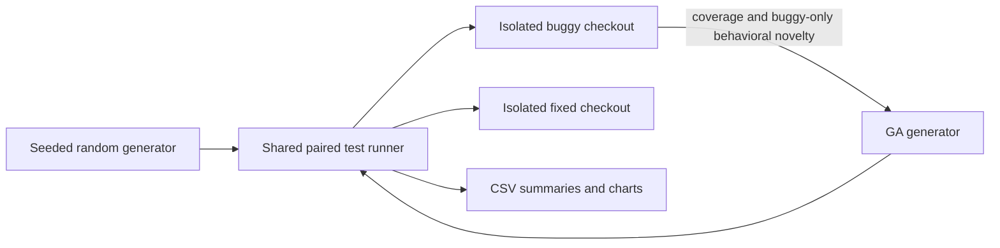

# AI-Guided vs. Random Testing

This project compares seeded random testing with a genetic algorithm (GA) for
the BugsInPy `youtube-dl` Bug 1 target, `youtube_dl.utils._match_one`.

## Benchmark and verification

The benchmark checkouts are kept unchanged:

- Buggy: `target_program/buggy_source`, commit
  `99036a1298089068dcf80c0985bfcc3f8c24f281`
- Fixed: `target_program/fixed_source`, commit
  `1cc47c667419e0eadc0a6989256ab7b276852adf`
- Regression test: `test/test_utils.py::TestUtil::test_match_str`
- Bug trigger: `filter_part="is_live"` and `dct={"is_live": false}`. The buggy
  implementation returns `true`; the fixed implementation returns `false`.

The buggy checkout's original test passes but predates the boolean regression
assertions. The fixed checkout's test includes those assertions. The experiment
therefore runs both tests and separately probes the documented trigger before
collecting measurements.

The benchmark metadata records Python 3.7.0. The available project virtual
environment used for validation in this workspace is Python 3.12.1. The
original test has been verified under that environment; Python 3.7 compatibility
is not claimed as locally verified.

## Setup

From the project root, activate the existing `.venv` or create a compatible
environment, then install:

```powershell
.\.venv\Scripts\Activate.ps1
python -m pip install -r requirements.txt
```

## Run

Run a pilot (2 paired seeds, 50 generated inputs per method and seed):

```powershell
python -m src.main --pilot --verify-reproducibility --output-dir results\pilot
```

Run the main experiment (10 paired seeds, 200 generated inputs per method and
seed):

```powershell
python -m src.main --runs 10 --budget 200 --seed 20261021 --output-dir results
```

Run the budget sweep (10 paired seeds at each budget from 10 through 100,
in steps of 10):

```powershell
python -m src.budget_sweep --runs 10 --start-budget 10 --end-budget 100 --step 10 --seed 20261021 --output-dir results
```

The sweep stores each budget's detailed experiment data under
`results/budget_sweep/budget_<n>/`, writes the combined means and standard
deviations to `results/budget_sweep_summary.csv`, and saves the sweep figures
in both `results/` and `results/graphs/`.

Source paths, timeout, population size, seed, run count, and evaluation budget
can be overridden with command-line options. The runner refuses unexpected
checkout commits instead of silently measuring a different version.

## Outputs

The experiment writes detailed observations and aggregate summaries to the
selected output directory:

- `random_results.csv`, `ai_results.csv`, and `all_results.csv`
- `comparison.csv`, `run_summary.csv`, `coverage_summary.csv`,
  `fault_detection_summary.csv`, and `timing_summary.csv`
- Separate PNGs directly in the results directory:
  `coverage_comparison.png`, `fault_detection_comparison.png`,
  `generation_overhead_comparison.png`, `total_runtime_comparison.png`, and
  `coverage_progression.png`
- Copies of those five PNGs in `graphs/`
- Budget sweep charts: `budget_fault_exposure.png`, `budget_coverage.png`, and
  `budget_generation_overhead.png` when the sweep command is run
- `graphs/README.md` explains the meaning, units, and axes of each chart

The system architecture diagram is generated at
`diagrams/system_architecture.png`. Charts are generated by reading the CSV
files written for the same experiment. Every chart has labeled axes, a short
in-image explanation, and is titled
"Intelligent Test Input Generation Using AI for Improving Random Testing
Effectiveness."

## Architecture



The GA does not receive the fixed-side output as a fitness signal. The fixed
checkout is used only by the shared evaluation runner to determine whether an
input distinguishes the versions.

For the algorithm, statistical assumptions, limitations, and reproducibility
details, see [methodology.md](./methodology.md).