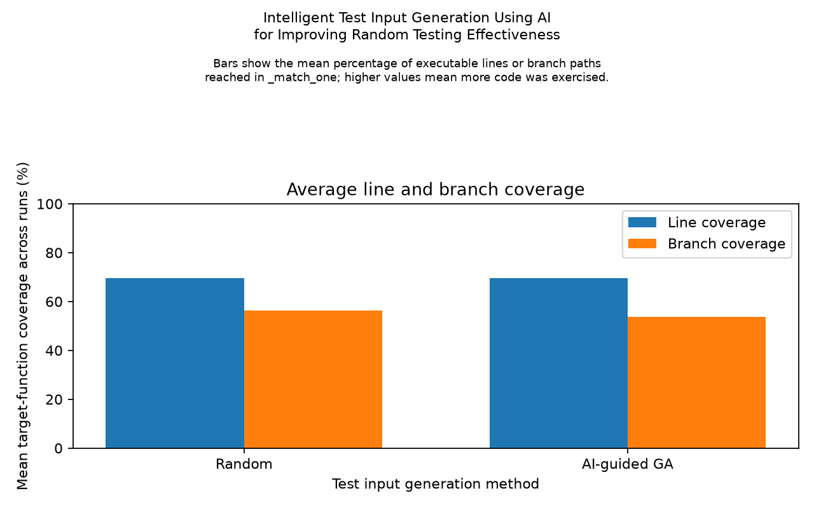
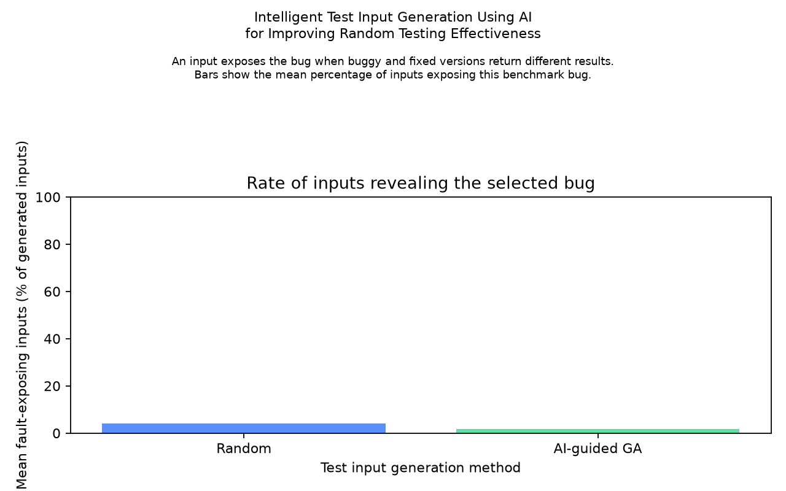
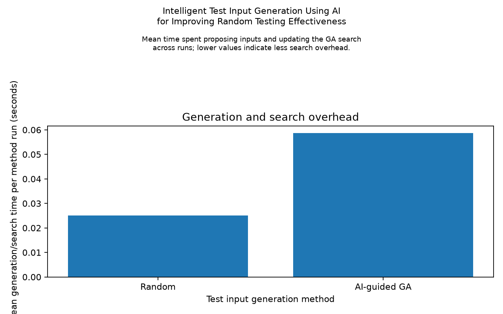
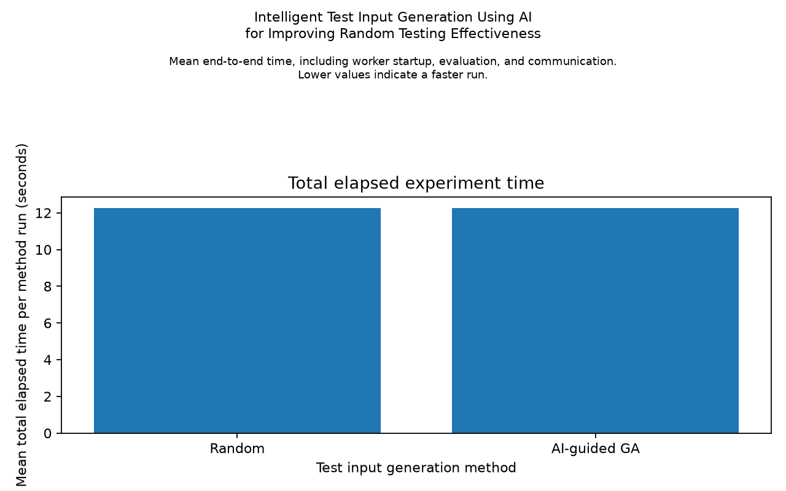
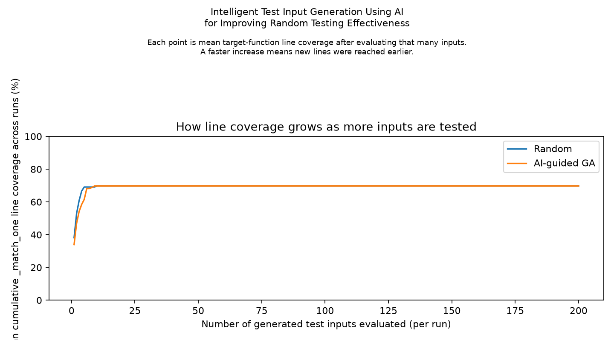

# Intelligent Test Input Generation Using AI for Improving Random Testing Effectiveness

## Experiment status

The pilot and main experiments completed using the local Python 3.12.1
environment. Both source checkouts matched the benchmark commit hashes, the
original `test_match_str` test passed in both checkouts, and the explicit
`is_live=False` probe returned `True` for the buggy version and `False` for the
fixed version. The buggy-side original test does not contain the regression
assertions added to the fixed checkout, so its passing result alone does not
reproduce the fault.

The pilot used 2 seeds and 50 generated inputs per method/run. Repeating the
first seed reproduced generated inputs, outcomes, and coverage. The main
experiment used 10 paired seeds (`20261021` through `20261030`) and 200 inputs
per method/run. There were 4,000 generated inputs and 8,000 target executions
overall. Each generated input ran once on each implementation. No generated
input caused a target exception.

The benchmark metadata records Python 3.7.0; this machine's `.venv` used Python
3.12.1. Compatibility with Python 3.7 syntax was checked, but experiment
execution on Python 3.7 was not performed.

## Main results

| Metric | Random | AI-guided GA | GA minus random | Paired permutation p |
|---|---:|---:|---:|---:|
| `_match_one` line coverage | 69.70% | 69.70% | 0.00 pp | 1.0000 |
| `_match_one` branch coverage | 56.25% | 53.75% | -2.50 pp | 0.1250 |
| Inputs exposing Bug 1 (mean of 200) | 8.0 (4.00%) | 3.4 (1.70%) | -4.6 | 0.015625 |
| Generation/search overhead per run | 0.0250 s | 0.0587 s | +0.0336 s | 0.001953 |
| Target execution time per 400 calls | 0.1034 s | 0.1110 s | +0.0076 s | 0.2090 |
| Total wall-clock time per run | 12.2469 s | 12.2523 s | +0.0054 s | 0.9609 |

Line coverage was 23 of 33 executable statements for every run. Branch
coverage was measured by coverage.py within `_match_one()` and was 9 of 16
branch arcs for every random run; the GA averaged 8.6 of 16 arcs.

The random method exposed the selected fault in all 10 runs (80 inputs total).
The GA exposed it in 6 of 10 runs (34 inputs total). In both methods, the
distinct-fault count is at most one because this benchmark contains one selected
bug. Fault-exposing input counts are repeated observations of that same fault,
not counts of independent faults.

The paired comparison used the exact two-sided sign-flip permutation test over
the 10 seed-paired differences. The p-value for fault-exposing input count is
0.015625 in this particular benchmark; it should not be generalized beyond
this single fault and input domain. The GA had higher generation/search
overhead, while total elapsed time was nearly equal because worker startup and
inter-process communication dominated the measured run time. Target execution
time did not show a statistically detectable difference here.

## Interpretation and limitations

In this experiment, the GA did not improve line coverage and produced slightly
lower branch coverage than random generation. It found fewer inputs exposing
the selected boolean regression and required more generation/search overhead.
The fitness signal used only buggy-side coverage and buggy-side outcome
novelty; fixed-side behavior was used only by the evaluation runner.

These observations describe one BugsInPy bug, a finite structured input
domain, 10 seeds, and the specific fitness weights and GA settings recorded
in the source. They do not show that random testing is generally superior, nor
that AI-guided testing is ineffective for other applications. The line
coverage ceiling also reflects a narrow target function and generated domain.

## Figures











## Reproducibility

From the project root, activate `.venv` and run:

```powershell
python -m src.main --runs 10 --budget 200 --seed 20261021 --output-dir results
```

The generated observations and aggregates are in `../results/`, including
[`all_results.csv`](../results/all_results.csv),
[`comparison.csv`](../results/comparison.csv),
[`run_summary.csv`](../results/run_summary.csv),
[`coverage_summary.csv`](../results/coverage_summary.csv),
[`fault_detection_summary.csv`](../results/fault_detection_summary.csv), and
[`timing_summary.csv`](../results/timing_summary.csv). The images are saved
individually in `../results/` and duplicated under `../results/graphs/`.
